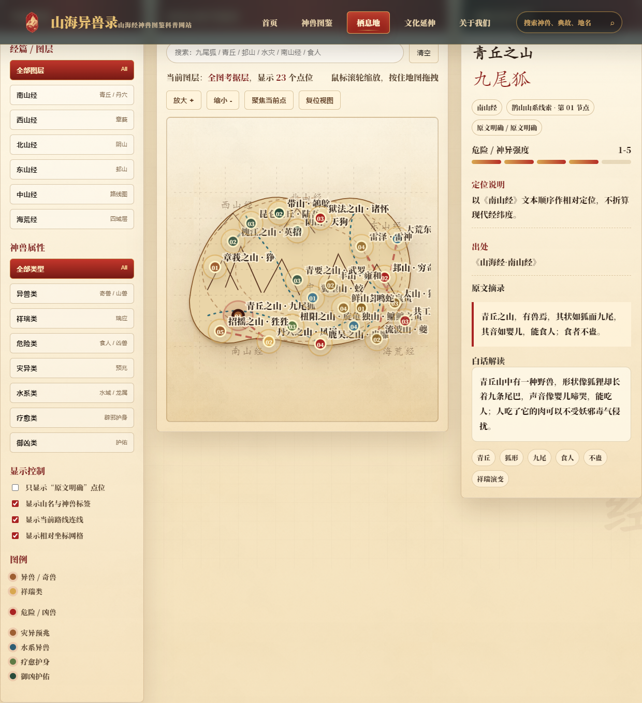
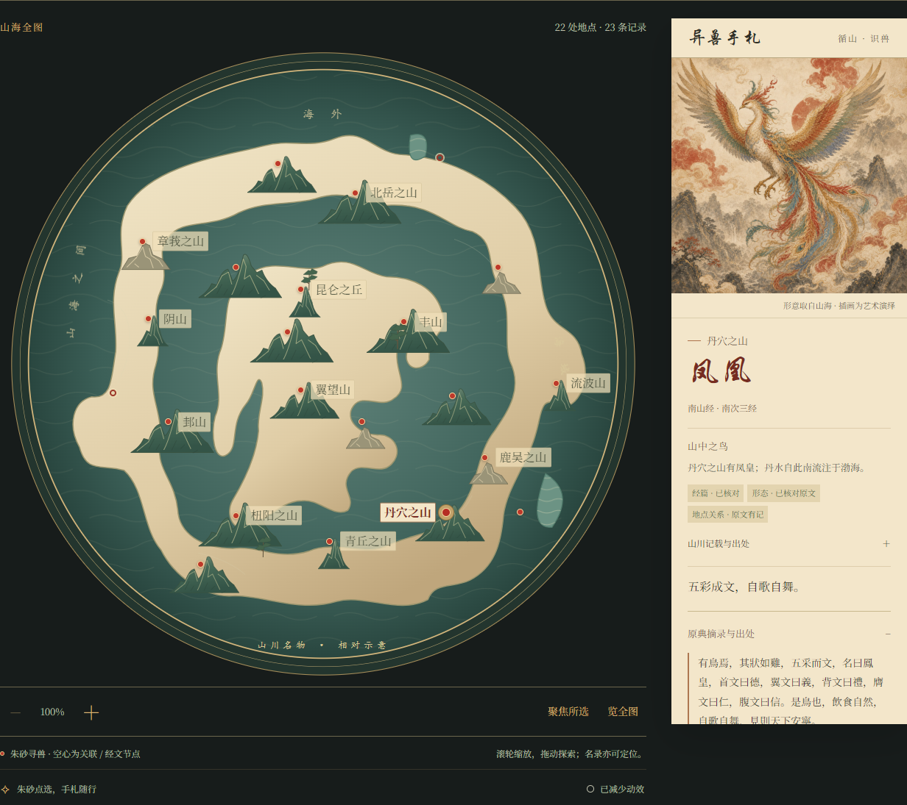
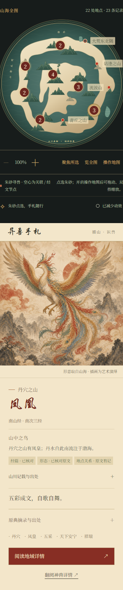

# 山海地图分支与 PR 改动汇总

整理日期：2026-10-20。来源分支：`feat/local-culture-beasts-merge`；本 PR 分支：`codex/habitat-map-complete`；目标：`main`。

## 来源分支与提交范围

来源分支包含地图初版、后续本地地图优化，以及已合并的神兽图鉴和文化首页改版。本 PR 从远端 `main` 单独整理地图的最终实现、图片、来源记录及直接配套修正；图鉴和文化首页的大幅设计改版继续保留在来源分支，不随此 PR 发布。两页仅同步此前确定的页脚署名。

原工作目录与分支保持原状。所有整理、提交和发布在独立工作区进行，不重写原分支历史。

## 交互地图与地域阅读

- 保留 `map.html` 和 `habitat-detail.html` 地址，将栖息地页整理为与首页配色一致的青绿山水画卷，提供总图与山系局部两种阅读方式。
- 收录 22 处地点、23 条异兽记录、14 个山系／海荒篇章分组，以及堂庭、猿翼两个经文辅助节点；辅助节点不增加异兽或栖息地点总数。
- 支持鼠标拖动、滚轮与按钮缩放、聚焦所选、热点聚合、地名避让，以及手机操作模式与双指缩放；手机默认仍可滑动页面。
- 支持经篇、山系、类型、分项待辨状态及关键词组合筛选；地图热点、名录、同地异兽切换和异兽手札同步更新。
- 地域详情显示所选山川、关联异兽、环境原段及出处；参数链接、浏览历史及详情返回保留筛选和相机状态。

## 原典依据与路线

- 逐条保留原典摘录、条目定位、分项证据和图像说明，区分原典、版本异文、现代解释及艺术演绎。
- 地图采用相对位置与路线示意，不宣称现代经纬度或古图复原；应龙住所关系和带山异鸟字形继续单列待辨。
- 首批五条有相邻原文依据的经文路线显示方向箭头、引句与文字里数；五条本站浏览顺序采用虚线，避免两者混淆。不跨接缺少中间节点的路段，不由图上线长推断实际里程。
- 全图、山系局部及地域小地图使用共享 SVG 绘图；无脚本底图同步生成，命名水域与装饰地形分层展示。

## 最终画面与动效

- 去除造成横向白雾分层的纹理覆盖、遮挡地图的中央装饰文字，以及棕色狐狸、乌龟和鱼形线描；修正两处装饰湖面的填色与水纹对齐。
- 地图及地域详情的导航采用首页相同的位置、宣纸底色、细金边、云纹及朱砂选中状态。最终导航保持静态，已移除游龙金边和导航扫光。
- 主动点击地点、名录或经文路段后播放墨晕、星芒与朱砂扩散圈，同点不限次数重播；约 4.8 秒后转为当前点位常驻的灵气涟漪。切换地点、拖动、缩放时保持正确定位，不叠加旧效果。
- 增强墨晕、星芒、涟漪及经文路线流光的可见度；星芒和涟漪的视觉范围小于主墨晕。提供暂停／恢复，遵循减少动态效果设置、后台状态与存储不可用降级。
- 顶部采用已有山水背景并放大标题，仅介绍文字参与渐显上移入场；地图、手札、工具栏和名录直接显示。

## 23 张插画与完整展示

- 使用用户提供的 14 张图片补齐缺图，保留原有九张；23 条记录在地图手札、名录与地域详情中均有配图。
- 新增网页副本等比缩小并压缩为 1024×1024 JPEG，用户原文件保留；图片继续标注艺术演绎，不据图改写原典形态。
- 手札按原图比例完整展示，取消横向裁切与平板拉伸；说明文字移至图下，避免遮住头部、翼尖、身体和尾部。保留图片加载失败与关闭脚本时的提示或默认内容。

## 配套修正与清理

- 全站 15 个现有页面采用统一页脚署名“山海异兽录·山海经神兽图鉴科普网站”。文化详情的错误属性引号修正，恢复相关链接与缩略图。
- 删除 `main` 中实际存在的旧版首页、结构图辅助页及仅用于旧首页的样式。整合分支曾有的重复高级图鉴及专用样式不在 `main` 中，本 PR 不重新引入。
- 补齐实现方案、资料核查、来源与验收记录。参与感方案明确保留为规划稿；个人收藏、探访任务及笔记尚未实现，不列为本次功能。

## 复查与画面对照

保留 HTML、CSS、JavaScript 静态实现，无需后端、数据库、安装依赖或构建。正式网站不读取本机检查工具、临时截图、浏览器目录或文献原件。

本次发布分支的实际复查结果见 [PR 提交前验收](habitat-map-validation.md#2026-10-20-独立-pr-分支提交前验收)。此前逐轮验证记录继续保留；涉及旧状态时，以对应的后续修正及本汇总的最终行为为准。

| 远端原地图 | 当前桌面地图 | 当前手机地图与手札 |
| --- | --- | --- |
|  |  |  |
