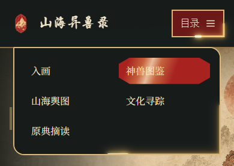

# 全站导航游龙金边与扫光

2026-10-20 按用户最新要求，将此前地图页恢复的亮金拖尾、浅金亮点及当前栏目扫光应用到全部现有顶部主导航。Git 中先前的 `02e8592` 及其撤回 `9d2b688` 保留；本轮沿用共享组件文件名，视觉参数取自删除前的地图版本，没有直接回滚整站文件。

## 当前效果

- 金色拖尾：`#f0c878`、3px、占路径周长的 24%，带原版双层柔光。
- 浅金亮点：`#fff7d8`、3.8px、占路径周长的 3%，与拖尾前端同步移动。
- 两条描边每 5 秒沿导航边框循环，贴合实际尺寸和圆角。页面原边框、宣纸底色、云纹、链接及桌面排版继续使用原样式。
- 已标记的当前栏目每 5.2 秒播放原版斜向金色扫光。扫光使用独立装饰节点，保留旧样式页原有下划线；海报页原本没有当前栏目，不新增错误的栏目选中标记。
- 装饰不参与布局、不接收指针或焦点，不进入辅助技术的阅读顺序。

## 维护与接入

共享组件为 `css/navigation-flow.css` 与 `js/navigation-flow.js`。在有顶部主导航的页面样式之后引入：

```html
<link rel="stylesheet" href="css/navigation-flow.css">
<script src="js/navigation-flow.js" defer></script>
```

组件仅装饰 `header` 中标记为“主导航”“移动端主导航”的导航及关联目录按钮。当前项使用链接上的 `aria-current="page"`、`.is-current` 或 `.active` 标记。新增页面应保持这些现有语义；页脚、正文目录、侧栏、面包屑、详情页返回入口均不属于此组件范围。字体加载、窗口及容器尺寸变化自动适配，也可调用 `window.ShanhaiNavigationFlow.refresh()`。

当前接入首页、神兽图鉴、山海地图、地域详情、文化寻踪、文化详情、原典摘读列表、原典条目、关于页及海报页，共 10 页。16 个神兽详情页沿用现有返回图鉴与阅读目录，结构图辅助页沿用原布局。

手机端沿用各页既有菜单。图鉴、文化详情、关于页、海报页此前没有完整紧凑目录控制，组件复用现有链接提供 1000px 以下的目录按钮，支持展开、Escape、点击外部或链接后关闭；不复制第二份导航链接。图鉴最窄屏页头适当缩小品牌文字及图标，保证目录可用。

页脚提供“暂停导航动效／开启导航动效”，同时控制金边与扫光。暂停偏好存于 `shanhai-nav-motion-paused`，跨页、刷新、标签间同步；存储不可用仍可在当前页暂停。地图页原有“暂停动效”也会暂停本页导航。系统减少动态效果、页面后台及导航移出视口时停止，恢复后继续；不使用逐帧 JavaScript 绘制。打印时隐藏动效装饰和开关，禁用脚本时保留页面自身导航与降级内容。静态 `file://` 浏览无需构建或外部依赖。

## 验证

Windows Edge / Playwright 实际完成：

- 根目录 27 页分别在 1400、390px 下打开，10 个接入页面另在 768px 下打开，共 64 组，无横向溢出或新增控制台、脚本、资源错误；浏览器自身 `favicon.ico` 请求单独排除。
- 10 个接入页桌面页头、各主导航及链接坐标和尺寸逐项对照修改前基线，均保持一致；所有导航链接目标文件存在。10 页 HTML 仅增加两条组件引用，其他 17 页没有修改。
- 实际展开 15 组手机／平板菜单，检查金边尺寸、点击命中、Escape 与外部点击关闭。首页、图鉴、地图、关于页和文化页另在 320、1000、1024、2048px 下检查，共 20 组，无横向溢出。
- 对实际动画不同时刻采样，确认两条描边和选中项扫光均在移动；颜色、线宽和周期与旧地图效果一致，没有第二套描边叠加。
- 检查全站暂停、刷新与跨页保存、跨标签同步、系统减少动态效果、后台及视口外停止与恢复；地图暂停同时停止金边和扫光。
- 地图经文路线流光、同点重复唤醒与其后的常驻涟漪正常；首页画卷切换、图鉴搜索、原典摘读搜索正常。
- 检查 `file://` 直接打开、地图禁用脚本降级、存储不可用、重复脚本加载及打印；脚本通过语法检查。
- 已实际查看地图、首页、关于页桌面导航近景，以及图鉴、地图、原典条目手机展开目录，确认采用原版亮金拖尾和扫光。

本机修改前备份、检查脚本、截图及 `validation.json` 位于已忽略的 `test-results/navigation-gold-global/`。以上为 Windows Edge 的桌面与响应式检查，未新增实体手机认证。此次只更改导航界面及地图暂停提示，没有改写知识内容、地图点位、插画或页面正文，也没有新增外部素材。

## 视觉对照

修改前（当前主分支的地图导航）：


修改后（原版亮金拖尾、浅金亮点与当前栏目扫光的一个时刻）：


手机图鉴展开目录：


